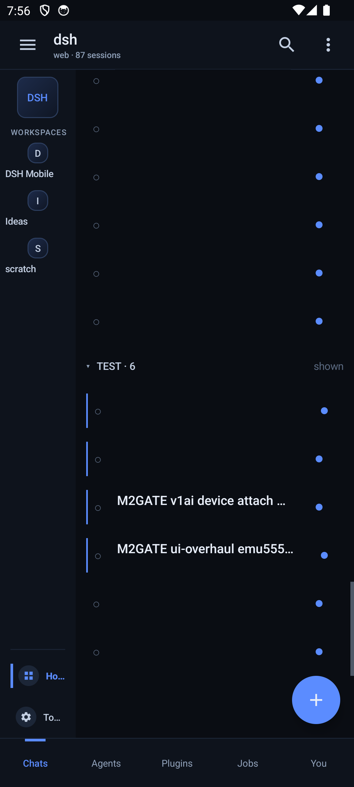
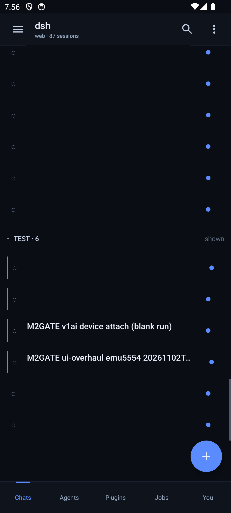
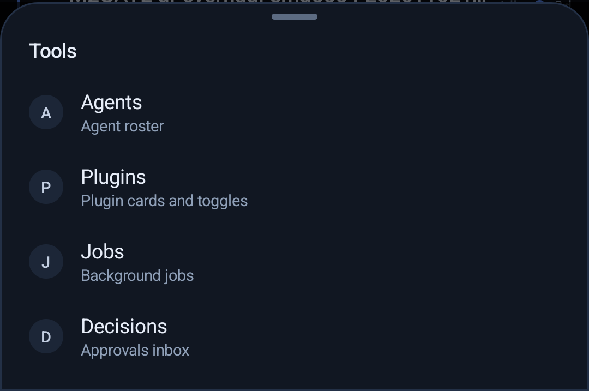
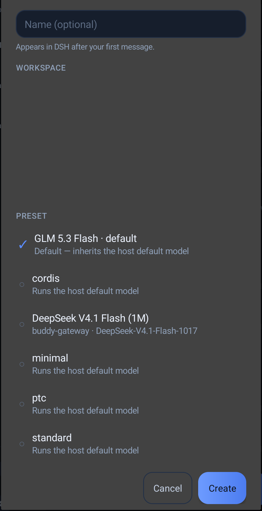

# DSH Native — a zero-dependency Android client for DeepSeek Harness

A genuinely native Android client (no WebView) for [DeepSeek Harness](https://github.com/deepseek-ai/dsh):
chat, streaming transcripts, workspaces, plugins, jobs and decisions — built with **no Gradle, no
AndroidX, no Compose, and zero dependencies**. The whole app is plain Java + platform views, built by
`aapt2 → javac → d8 → apksigner` in one script.

| | |
|---|---|
|  |  |
|  |  |

*Screenshots come from a development device; personal content (session titles, paths,
workspace names) is redacted.*

## Features

- **Discord-mobile-shaped navigation** — a workspace rail (workspaces ≈ servers, sessions ≈ channels)
  plus Home / Agents / Plugins / Jobs / You tabs.
- **Collapsible rail** — hidden by default on phones so the content gets the full width; a hamburger
  in the top bar brings it back, and it remembers your choice.
- **Test channel** — a client-side classifier (`ADR-0010`) groups probe/gate sessions into a
  collapsed `TEST · N` row after Recent, so they never pollute your real lists. Expandable in place,
  persisted, scope-aware.
- **Streaming transcript** with SSE, incremental rendering, jump-to-latest.
- **New-session sheet** — name, workspace picker, preset picker with a tolerant optional `model`
  field, human error copy.
- **Plugins / Jobs / Decisions / Agents** surfaces, plugin switches, job kill/copy dialogs.
- **Pairing by QR/URL**, session cookie auth, LAN gateway friendly.

**New here? → [QUICKSTART.md](QUICKSTART.md)** walks from a fresh clone to a paired phone.

## Build

Prerequisites: JDK 17+, Android SDK build-tools (`aapt2`, `d8`, `apksigner`) and `platforms;android-34`.

```bash
./tools/setup-toolchain.sh        # checks/fetches the SDK pieces
./build-native.sh                 # -> dist/dsh-native.apk
adb install -r dist/dsh-native.apk
adb shell am start -n dev.dsh.harness/.ConnectActivity
```

The build script is the whole toolchain: compile resources, link, compile Java, dex, package, sign.
A local signing key is generated into `signing/` on first build (gitignored — never commit keys).

## Install / pair

The app connects to a DeepSeek Harness host. Start the host, run the mobile API plugin, then pair the
phone with the host URL/token (QR or URL). The LAN gateway (`tools/mobile-gateway.mjs`) lets a phone
reach the loopback host over your network without restarting it:

```bash
./tools/start-gateway.sh 0.0.0.0 3091 3080
```

## Plugin (host side)

`plugin/` contains the mobile API plugin that exposes the JSON API the client reads
(`/api/mobile/v1/…`: bootstrap, sessions, messages, stream, presets, decisions, jobs). Install it into
your DSH profile, restart the host, and the app will find the roster.

## Repository layout

```
app-native/        the Android app (plain Java, res/, AndroidManifest.xml)
build-native.sh    aapt2 -> javac -> d8 -> apksigner
tools/             gateway, pairing, gate runner, plugin installer
plugin/            host-side mobile API plugin
docs/adr/          architecture decisions (stack, transport, projection, classification, ...)
docs/design/       UI specs
docs/screenshots/  README images
```

## Design constraints (the interesting part)

- **ADR-0001** — no Gradle/AndroidX/Compose/WebView; platform views only.
- **ADR-0002** — SSE streaming transport; never buffer the stream.
- **ADR-0003** — the client never parses harness session events; the backend projects message rows.
- **ADR-0010** — the Test channel is a closed, numbered client-side classification (no heuristics),
  with an `origin == "subagent"` guard.
- Hooks are a contract: `channel_row:` content-desc formats, `EVENT` logcat markers, ids — all
  documented in `docs/adr/`.

## License

MIT — see [LICENSE](LICENSE).
